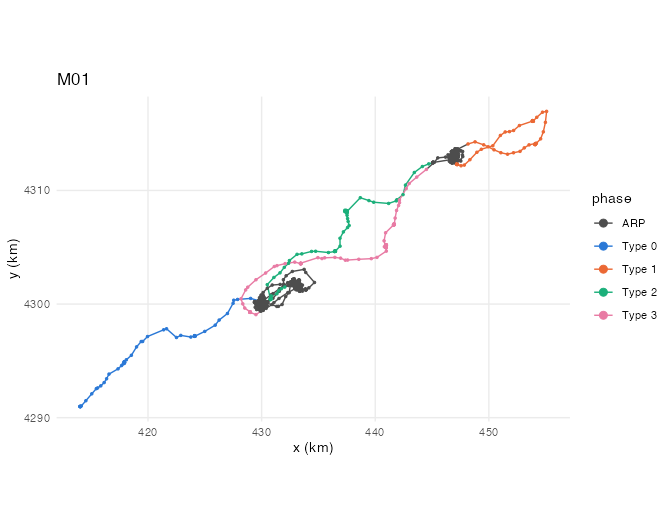
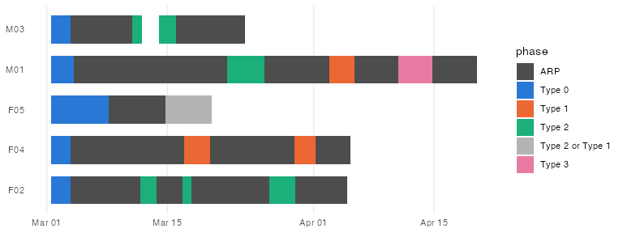

# disperseR

<!-- badges: start -->
<!-- badges: end -->

`disperseR` segments animal movement trajectories into **movement phases**, with
a focus on long-range movements. It separates area-restricted phases (ARP), where the
animal stays in a limited area, from the movements between them, and classifies
each movement according to the network of areas the individual has already
visited:

| Phase | Meaning |
|---|---|
| **ARP** | Area-restricted phase: the animal remains in a limited area (home range, settlement area, long stop). |
| **Type 0** | Unanchored movement: before the first ARP (e.g. after release or leaving the natal area). |
| **Type 1** | Loop: the animal leaves an ARP and returns to the same one. |
| **Type 2** | Expansion: the animal reaches a new ARP, not visited before. |
| **Type 3** | Internal transit: the animal moves to a different ARP that it had already visited. |
| **Type 2 or Type 1** | The track ends while the animal is moving, so the movement cannot be classified. |

At fine temporal resolution, hidden Markov models (HMM) mostly describe
*activity modes* (resting, moving), and a dispersing or migrating animal also rests every
day. `disperseR` uses the HMM states only as a first step and identifies phases
from space use over several days, with density-based clustering (DBSCAN).

## Installation

Once on CRAN:

``` r
install.packages("disperseR")
```

Development version from GitHub:

``` r
# install.packages("remotes")
remotes::install_github("cherraiz/disperseR")
```

From a local copy of the source:

``` r
install.packages("path/to/disperseR", repos = NULL, type = "source")
```

## Workflow

| Step | Function |
|---|---|
| Split tracks at long monitoring gaps | `divide.track.by.gap()` |
| Regularise locations with continuous-time movement models (`ctmm`) | `resample.ctmm()` |
| Fit hidden Markov models (`momentuHMM`) | `fitHMM.wrap()`, `draw.step.densities()` |
| Choose the clustering distance | `get.epsilon()` |
| Identify ARPs with DBSCAN | `get.arp()` |
| Link ARPs visited at different times | `link.arp()`, `draw.linked.clusters()` |
| Classify movement phases | `class.mov()` |
| Summarise and plot | `phase.summary()`, `draw.track()`, `draw.timeline()` |
| Transfer phases back to the original locations | `transfer.disperseR()` |

## Example

The package includes simulated data for five dispersing individuals:
`sim_tracks` (raw locations) and `sim_states` (regular locations with HMM
states).

``` r
library(disperseR)

eps <- get.epsilon(sim_states)
arp <- get.arp(sim_states, epsilon = eps, delta.days = 2, pct.state1 = 0.2)
mov <- class.mov(link.arp(arp, thres = 24 * 3600))
mov
#> <disperseR object>
#>   Individuals: 5 | Locations: 3788
#>   Steps: ARP clusters (get.arp), Linked ARPs (link.arp), Movement phases (class.mov)
#>   ARP clusters per individual:
#> F02 F04 F05 M01 M03
#>   4   2   1   4   2
#>   Locations per phase:
#>     ARP Type 0 Type 1 Type 2 Type 2 or Type 1 Type 3
#> F02 629     55      0    142                0      0
#> F04 649     54    130      0                0      0
#> F05 159    161      0      0              129      0
#> M01 854     63     72    103                0     95
#> M03 364     55      0     74                0      0

draw.track(mov, colour.col = "phase", ids = "M01", colour.path = TRUE, km = TRUE)
```



``` r
draw.timeline(mov)
```



``` r
ph <- phase.summary(mov)
head(ph[, c("ID", "phase", "from", "to", "duration_days", "distance_km")])
```

The vignette describes the whole workflow and, above all, how the choice of
each argument changes the classification:

``` r
vignette("disperseR")
```

## License

MIT © Cesar Herraiz
