# disperseR: from GPS tracks to movement phases

``` r

library(disperseR)
library(ggplot2)
theme_set(theme_minimal(base_size = 11) +
            theme(panel.grid.minor = element_blank(), axis.text = element_text(size = 8)))
```

## Why movement phases?

Dispersal links populations: it drives gene flow, the colonisation of
empty habitat and the persistence of metapopulations (Bowler & Benton
2005; Clobert et al. 2012). GPS tracks of dispersing animals, however,
mix several processes. An individual may explore after leaving its natal
area or after being released, stop for a few hours or days on the way,
settle temporarily, make excursions and come back, or move between areas
it already knows (Beier 1995; Zimmermann et al. 2005). Each of these
*movement phases* responds to different decisions and takes place at a
scale of days to weeks (Nathan et al. 2008; Getz 2022).

Separating them matters because animals use the landscape differently in
each phase. Habitat selection and the response to roads and human
infrastructure differ between resident and dispersing individuals, and
even between types of non-residential movement (Gastón et al. 2016;
Cisneros-Araujo et al. 2025). Connectivity models built from all
locations together, or from all locations outside home ranges, can
therefore misrepresent how permeable the landscape is for dispersers
(Elliot et al. 2014). Short stops during long movements act as stepping
stones that make long-distance dispersal possible (Saura et al. 2014).
In reintroductions, the length of the exploratory phase after release
and the time until settlement are key indicators of success (Berger-Tal
& Saltz 2014; Cisneros-Araujo et al. 2026a).

Many methods segment tracks into behavioural units (Edelhoff et
al. 2016; Gurarie et al. 2016). Hidden Markov models (HMM) fitted to
step lengths and turning angles are among the most widely used (Morales
et al. 2004; Langrock et al. 2012; McClintock & Michelot 2018). At fine
temporal resolution, however, their states mostly describe *activity
modes*, such as resting or moving, rather than movement phases: a
dispersing animal also rests every day, and a resident one also moves
within its home range (Getz 2022; Cisneros-Araujo et al. 2026b).
Identifying phases requires information on space use over longer
periods, such as residence time or spatial clustering (Barraquand &
Benhamou 2008; Gastón et al. 2016; Patin et al. 2020).

`disperseR` combines both scales. HMM states describe the activity of
each location. Density-based spatial clustering (DBSCAN; Ester et
al. 1996; Hahsler et al. 2019), together with minimum duration and
activity criteria, identifies **area-restricted phases** (ARP), such as
home ranges, transient residences or long stays. Short stops are not
ARPs and remain part of the movement. Finally, each movement between
ARPs is classified according to the network of ARPs the individual has
visited so far.

### The classification

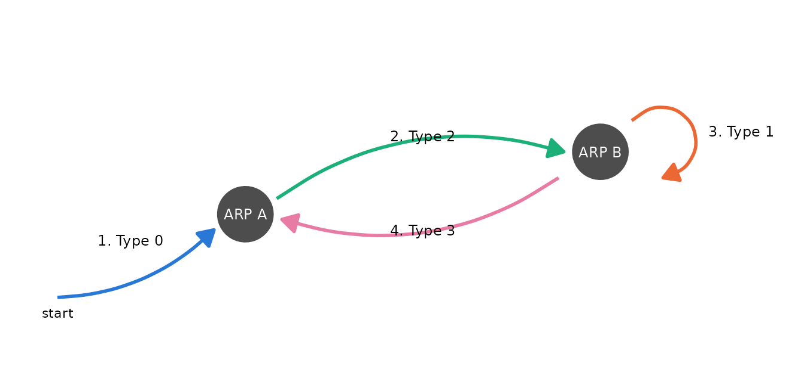

| Phase | Meaning | Usual terms (approximate) |
|----|----|----|
| ARP | Area-restricted phase | home range, transient residence, settlement |
| Type 0 | Unanchored movement, before the first ARP | natal or post-release exploration |
| Type 1 | Loop: leaves an ARP and comes back to the same ARP | excursion, foray |
| Type 2 | Network expansion: from a known ARP to a new ARP | dispersal, transition to a new residence |
| Type 3 | Internal transit: between two previously visited ARPs | return or movement between known residences; migration |

The equivalences in the last column are approximate. For example, a Type
2 movement may end in a transient residence that the animal later
abandons. Whether an ARP is a home range or a temporary stop depends on
how long it lasts and on the questions of the study, which is why the
duration criteria are arguments of the functions.

This vignette has two parts. **Part I** goes through the workflow with a
simulated data set. **Part II** shows how the main arguments change the
classification, and why.

## Part I. The workflow

### The example data

`sim_tracks` contains hourly GPS fixes of five simulated individuals,
with timing jitter and about 10% of fixes missing. The animals are
active at night and rest during the day, also while dispersing. Directed
movements follow meandering routes, and some include short stopovers of
half a day to a day. The column `behaviour` stores what each animal was
really doing in the simulation, so we can check the results:

- **M01** settles in an area made of two nearby patches and shuttles
  between them. It then moves to a second area, with a stopover on the
  way, makes a looping excursion, and returns to its first area.
- **F02** settles in one area, stays 2.5 days in a second one, and
  settles in two more, with a stopover before the last one.
- **M03** settles in one area and then makes a long transit, during
  which the collar fails for about two days.
- **F04** has a home range made of two nearby patches and makes two
  looping excursions from it.
- **F05** explores with several stopovers, settles for a few days,
  leaves again, and the tracking ends while it is still moving.

``` r

head(sim_tracks)
#>    ID           timestamp        x       y  sex behaviour
#> 1 M01 2024-03-01 12:00:52 414009.7 4290987 male    travel
#> 2 M01 2024-03-01 14:01:39 414028.4 4290984 male    travel
#> 3 M01 2024-03-01 15:59:22 414036.5 4290983 male    travel
#> 4 M01 2024-03-01 17:02:51 414033.6 4290983 male    travel
#> 5 M01 2024-03-01 17:56:32 414046.8 4290967 male    travel
#> 6 M01 2024-03-01 19:04:12 414140.5 4291042 male    travel
table(sim_tracks$ID, sim_tracks$behaviour)
#>      
#>       stay stopover travel
#>   F02  556       20    162
#>   F04  558        0    188
#>   F05  141       83    186
#>   M01  760       55    240
#>   M03  318        0    123
```

[`draw.track()`](https://cherraiz.github.io/disperseR/reference/draw.track.md)
draws the tracks, optionally coloured by any column:

``` r

behaviour_cols <- c(stay = "#4d4d4d", stopover = "#eb6834", travel = "#2a78d6")
draw.track(sim_tracks, colour.col = "behaviour", time.col = "timestamp", km = TRUE,
           palette = behaviour_cols)
```

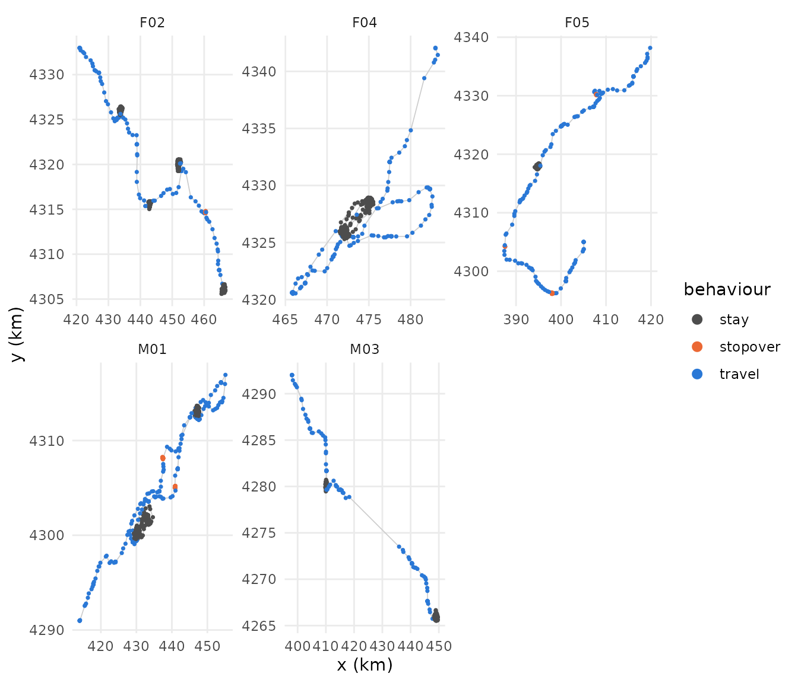

The fixes are irregular, and M03 has a gap of about two days:

``` r

dt_h <- unlist(tapply(as.numeric(sim_tracks$timestamp), sim_tracks$ID,
                      function(t) diff(sort(t)) / 3600))
summary(dt_h)
#>    Min. 1st Qu.  Median    Mean 3rd Qu.    Max. 
#>  0.8361  0.9575  1.0083  1.1321  1.0717 48.9328
ggplot(data.frame(dt = dt_h[dt_h <= 6]), aes(dt)) +
  geom_histogram(binwidth = 1 / 6, boundary = 0, fill = "#2a78d6", colour = "white") +
  scale_x_continuous(breaks = 0:6) +
  labs(x = "Interval between fixes (hours)", y = "Count", title = "Intervals up to 6 hours")
```

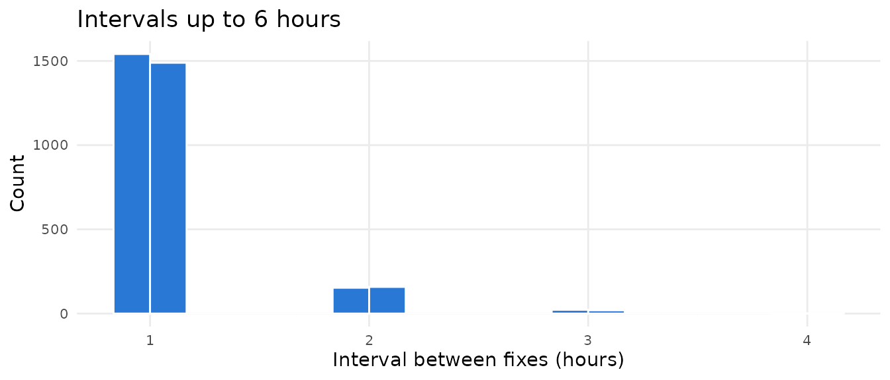

### 1. Splitting tracks at monitoring gaps

A continuous-time model would interpolate across the gap of M03 and
create locations that were never observed.
[`divide.track.by.gap()`](https://cherraiz.github.io/disperseR/reference/divide.track.by.gap.md)
splits each track wherever two consecutive fixes are more than
`gap.days` apart. `gap.days` can be a single value or a named list with
one value per individual:

``` r

split_trk <- divide.track.by.gap(sim_tracks, ids = "ID", time.col = "timestamp",
                                 gap.days = 1)
table(split_trk$id_split)
#> 
#> F02_1 F04_1 F05_1 M01_1 M03_1 M03_2 
#>   738   746   410  1055   223   218
```

``` r

draw.track(split_trk, colour.col = "id_split", ids = "M03", time.col = "timestamp",
           km = TRUE, palette = c(M03_1 = "#2a78d6", M03_2 = "#eb6834"))
```

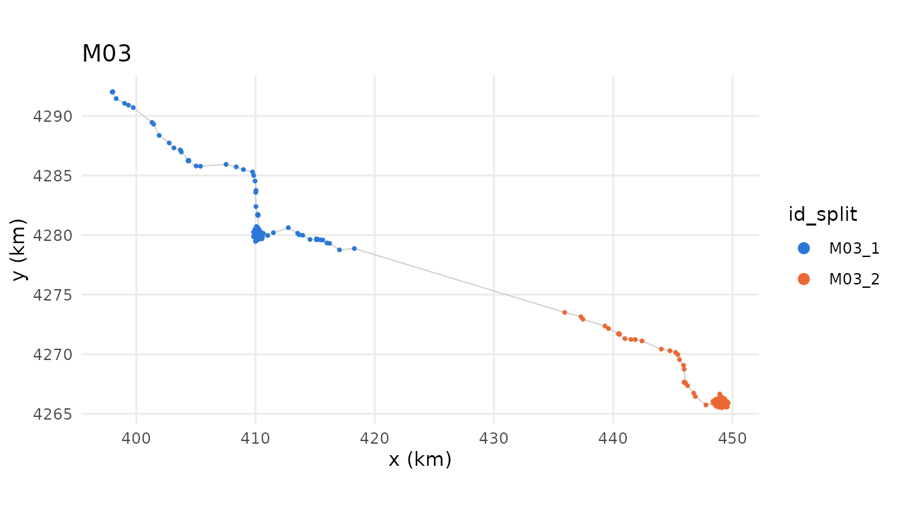

### 2. Regularising the tracks

[`resample.ctmm()`](https://cherraiz.github.io/disperseR/reference/resample.ctmm.md)
fits a continuous-time movement model (Calabrese et al. 2016) to each
track and predicts locations every `tint` seconds. Using `id_split` as
identifier resamples each segment separately, so nothing is predicted
inside the gap. `static.cols` copies individual attributes to the
output, and the output coordinates must be in metres:

``` r

reg <- resample.ctmm(as.data.frame(split_trk), tint = 3600, ids = "id_split",
                     timestamp = "timestamp", proj.in = 25830,
                     static.cols = "sex", verbose = FALSE)
```

Fitting the models takes a few minutes. Their result, together with the
HMM states of the next step, is stored in `sim_states`:

``` r

head(sim_states)
#>    ID id_split                time     time_s        x       y      step
#> 1 F02    F02_1 2024-03-01 11:56:18 1709294178 421007.4 4332970 11.328569
#> 2 F02    F02_1 2024-03-01 12:56:18 1709297778 421003.0 4332981  4.452588
#> 3 F02    F02_1 2024-03-01 13:56:18 1709301378 420998.6 4332980 14.710357
#> 4 F02    F02_1 2024-03-01 14:56:18 1709304978 420983.9 4332982 10.645083
#> 5 F02    F02_1 2024-03-01 15:56:18 1709308578 420977.4 4332973 45.049463
#> 6 F02    F02_1 2024-03-01 16:56:18 1709312178 420933.4 4332964 27.676805
#>        angle state    sex
#> 1         NA     2 female
#> 2  1.2054030     2 female
#> 3 -0.1107382     2 female
#> 4  0.9873524     2 female
#> 5 -0.6900414     2 female
#> 6  2.9844871     2 female
```

### 3. Behavioural states

[`fitHMM.wrap()`](https://cherraiz.github.io/disperseR/reference/fitHMM.wrap.md)
fits an HMM with gamma step lengths and wrapped Cauchy turning angles.
State 1 is *Transit* and state 2 is *Encamped*. Because our animals rest
every day, we add a third, *stationary* state (`stationary = TRUE`),
which is merged into the encamped state after fitting. Part II shows
what happens without it.

The model is fitted by segment (`id_split`), so that no step crosses the
gap of M03.
[`fitHMM.wrap()`](https://cherraiz.github.io/disperseR/reference/fitHMM.wrap.md)
returns the identifier in a column named `ID`, which here holds the
segment:

``` r

reg <- sim_states[, c("id_split", "time", "x", "y", "sex")]

hmm <- fitHMM.wrap(reg, ids = "id_split", stationary = TRUE,
                   mean.step.1 = 700, sd.step.1 = 400,
                   mean.step.2 = 150, sd.step.2 = 100,
                   ang.con.1 = 0.7, ang.con.2 = 0.1)
```

Fitting the model takes about half a minute. To keep this vignette quick
to build, the two models it uses were fitted beforehand with the code
shown, and their results are loaded from a file. Everything else runs as
you read it.

``` r

hmm$models$global_model$mle$step
#>       Transit Encamped Stationary
#> mean 652.7565 154.7892  15.230356
#> sd   389.3305  92.7620   9.155337
```

To continue by individual, the segment number is removed from `ID`:

``` r

st <- hmm$data
st$id_split <- as.character(st$ID)
st$ID <- sub("_[0-9]+$", "", st$id_split)
st$state_name <- ifelse(st$state == 1, "Transit", "Encamped")
draw.track(st, colour.col = "state_name", km = TRUE,
           palette = c(Transit = "#eb6834", Encamped = "#2a78d6"))
```

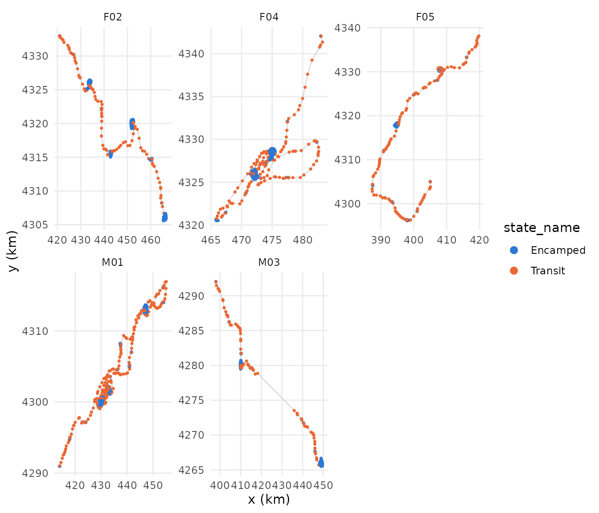

The model can also be fitted to each individual or segment
(`mode = "individual"`) or to groups defined by a column
(`mode = "groups"`).

### 4. Area-restricted phases

DBSCAN groups locations that are closer than a distance `epsilon`.
[`get.epsilon()`](https://cherraiz.github.io/disperseR/reference/get.epsilon.md)
estimates it from the step lengths. By default it is the step length at
which the densities of the two states intersect:

``` r

eps <- get.epsilon(sim_states)
eps
#> [1] 238.4065
draw.step.densities(sim_states, threshold = eps)
```

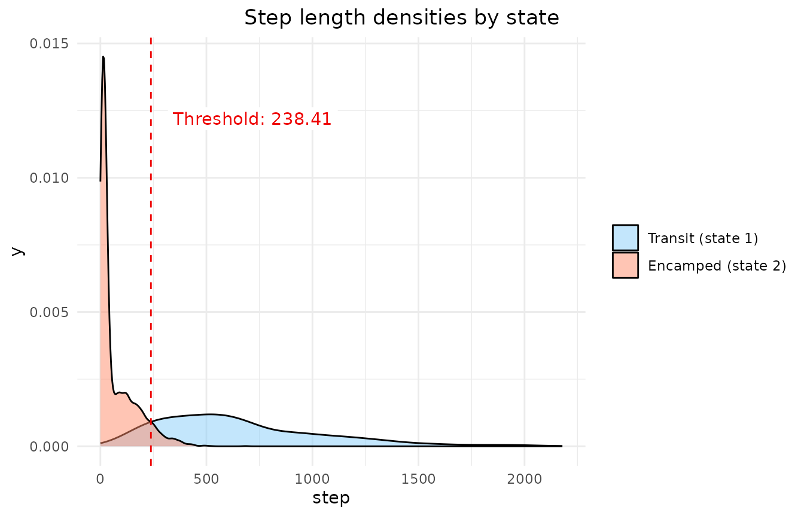

[`get.arp()`](https://cherraiz.github.io/disperseR/reference/get.arp.md)
runs DBSCAN on each individual and keeps as ARPs the clusters that last
at least `delta.days` (from their first to their last location) and have
less than `pct.state1` of their locations in the transit state:

``` r

arp <- get.arp(sim_states, epsilon = eps, delta.days = 2, pct.state1 = 0.2)
arp
#> <disperseR object>
#>   Individuals: 5 | Locations: 3788 
#>   Steps: ARP clusters (get.arp) 
#>   ARP clusters per individual:
#> F02 F04 F05 M01 M03 
#>   4   2   1   4   2
arp$arp_clusters$F02
#> # A tibble: 4 × 6
#>   cluster_id start               end                 dur_days pct_state1     n
#>        <int> <dttm>              <dttm>                 <dbl>      <dbl> <int>
#> 1          4 2024-03-03 18:56:18 2024-03-11 19:56:18     8.04    0.0103    194
#> 2          7 2024-03-13 18:56:18 2024-03-16 17:56:18     2.96    0.0139     72
#> 3          9 2024-03-17 18:56:18 2024-03-26 19:56:18     9.04    0.00917   218
#> 4         13 2024-03-29 20:56:18 2024-04-04 20:56:18     6       0         142
```

``` r

ad <- arp$data
ad$cluster <- ifelse(ad$arp, paste("ARP", ad$cluster_id), "not ARP")
arp_ids <- sort(unique(ad$cluster_id[ad$arp]))
cl_cols <- c("not ARP" = "grey80",
             setNames(rep(c("#2a78d6", "#eb6834", "#1baf7a", "#6250d6", "#e87ba4"),
                          length.out = length(arp_ids)), paste("ARP", arp_ids)))
draw.track(ad, colour.col = "cluster", km = TRUE, palette = cl_cols) +
  theme(legend.position = "none")
```

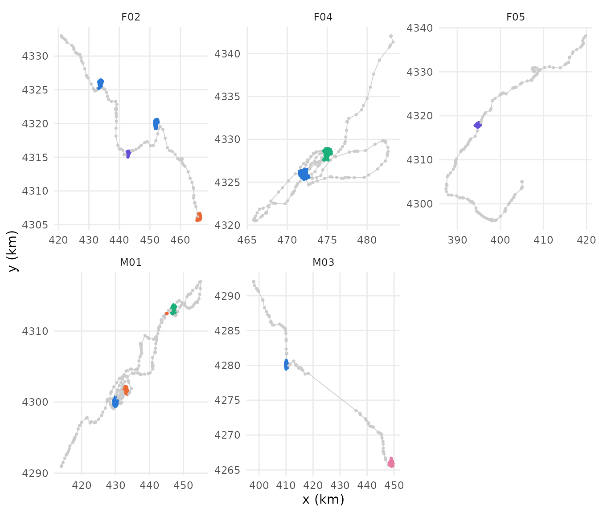

Daytime rests and stopovers during the movements also form small
clusters of encamped locations, but they last less than `delta.days` and
are not ARPs.

### 5. Linking ARP clusters

M01 and F04 move back and forth between two nearby patches, and DBSCAN
finds each patch as a separate cluster. Without linking, every trip
between them would be a separate movement.
[`link.arp()`](https://cherraiz.github.io/disperseR/reference/link.arp.md)
joins ARP blocks separated by less than `thres` seconds. The locations
in between are flagged as `arp_link`, and the linked clusters share a
`linked_clusters` identifier:

``` r

linked <- link.arp(arp, thres = 24 * 3600)
table(linked$data$ID, linked$data$arp_link)
#>      
#>       FALSE TRUE
#>   F02   823    3
#>   F04   791   42
#>   F05   449    0
#>   M01  1143   44
#>   M03   493    0
```

[`draw.linked.clusters()`](https://cherraiz.github.io/disperseR/reference/draw.linked.clusters.md)
shows each ARP cluster as a convex hull, the links as lines and the
linking locations as stars. It returns a `ggplot` object, so it can be
zoomed in like any other plot:

``` r

draw.linked.clusters(linked, ids = "F04", grid_spacing = 1000)
```

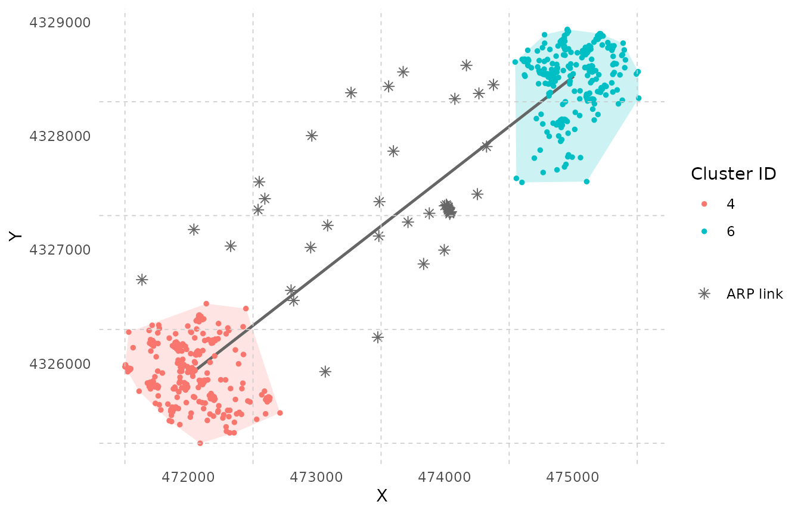

``` r

m01_arp <- linked$data[linked$data$ID == "M01" & linked$data$linked_clusters == "arp_1", ]
draw.linked.clusters(linked, ids = "M01", grid_spacing = 1000) +
  coord_cartesian(xlim = range(m01_arp$x) + c(-500, 500),
                  ylim = range(m01_arp$y) + c(-500, 500))
```

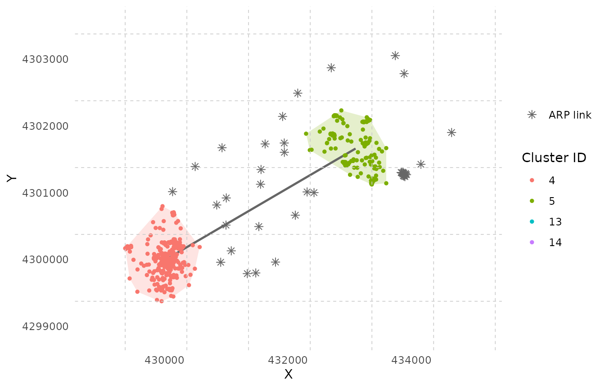

### 6. Movement phases

``` r

mov <- class.mov(linked)
mov
#> <disperseR object>
#>   Individuals: 5 | Locations: 3788 
#>   Steps: ARP clusters (get.arp), Linked ARPs (link.arp), Movement phases (class.mov) 
#>   ARP clusters per individual:
#> F02 F04 F05 M01 M03 
#>   4   2   1   4   2 
#>   Locations per phase:
#>     ARP Type 0 Type 1 Type 2 Type 2 or Type 1 Type 3
#> F02 629     55      0    142                0      0
#> F04 649     54    130      0                0      0
#> F05 159    161      0      0              129      0
#> M01 854     63     72    103                0     95
#> M03 364     55      0     74                0      0
```

The phases recover the simulated behaviour. M01 expands its network to a
second area (Type 2), makes a loop (Type 1) and returns to its first
area (Type 3). F04 makes two loops from its home range, and the tracking
of F05 ends during a movement whose destination is unknown
(`"Type 2 or Type 1"`):

``` r

draw.track(mov, colour.col = "phase", km = TRUE)
```

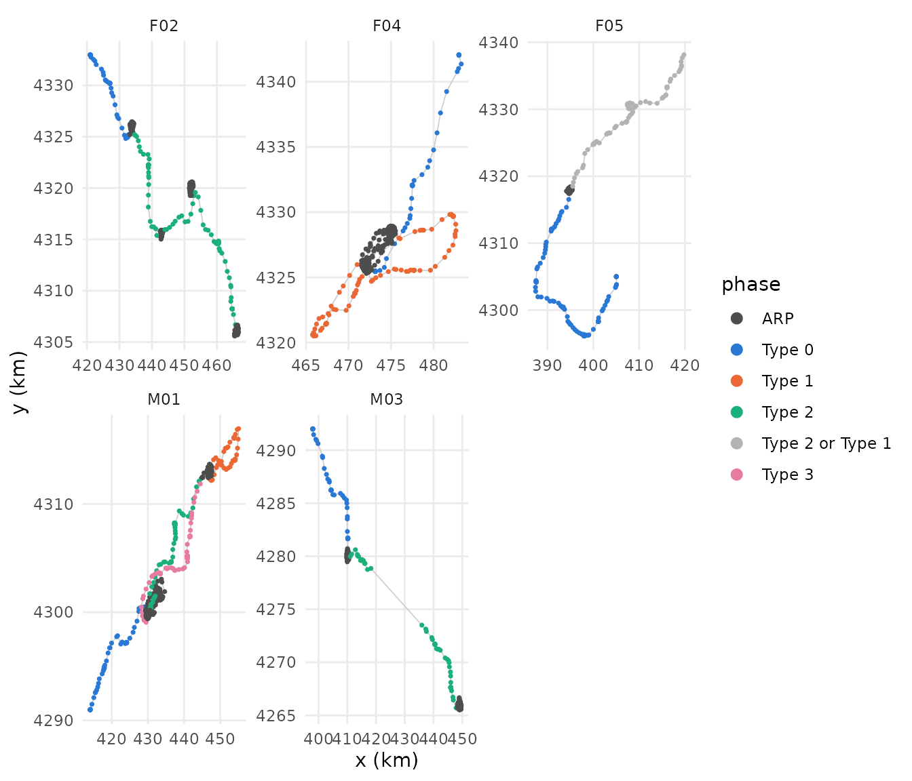

``` r

draw.track(mov, colour.col = "phase", ids = "M01", colour.path = TRUE, km = TRUE)
```

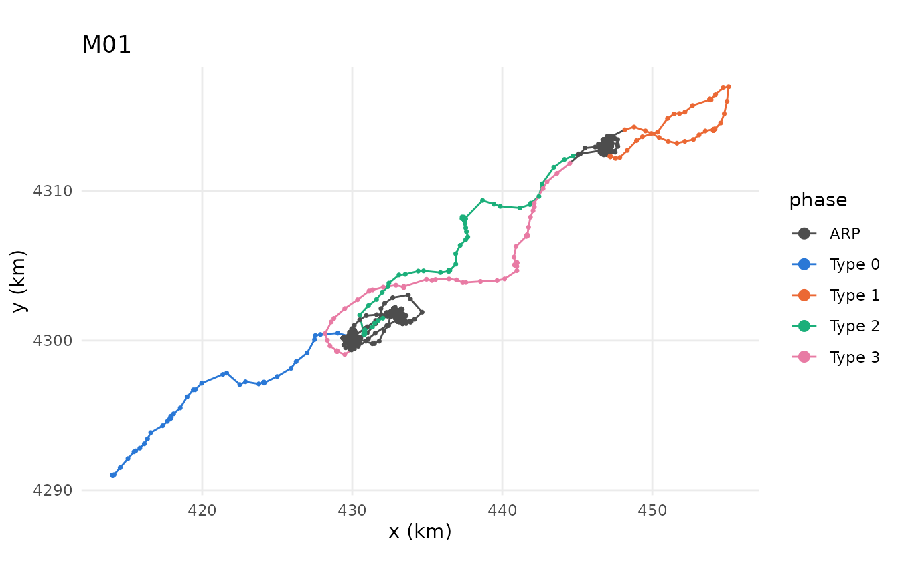

``` r

draw.track(mov, colour.col = "phase", ids = "F05", colour.path = TRUE, km = TRUE)
```

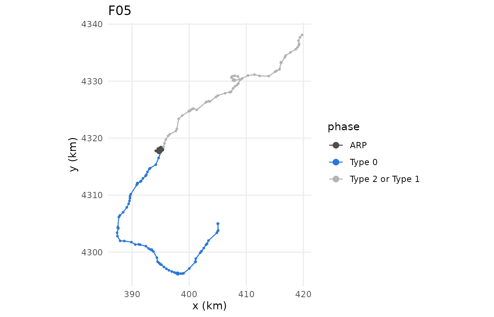

[`draw.timeline()`](https://cherraiz.github.io/disperseR/reference/draw.timeline.md)
shows the phases along time. Gaps in the monitoring are left empty:

``` r

draw.timeline(mov)
```

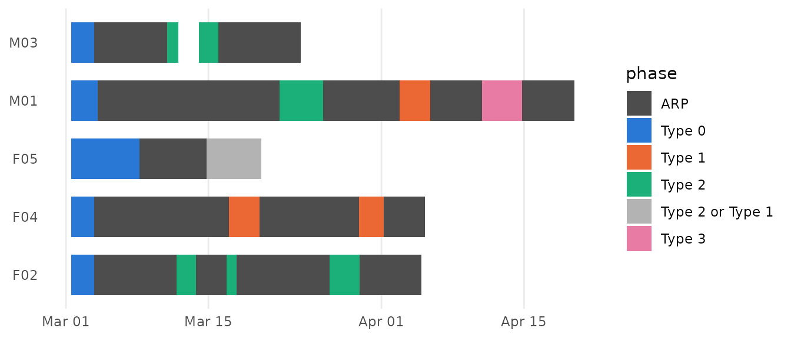

[`phase.summary()`](https://cherraiz.github.io/disperseR/reference/phase.summary.md)
turns the classification into a table with one row per phase, ready for
further analysis:

``` r

ph <- phase.summary(mov)
head(ph[, c("ID", "phase", "from", "to", "start", "duration_days", "distance_km")], 8)
#>    ID  phase  from    to               start duration_days distance_km
#> 1 F02 Type 0  <NA> arp_1 2024-03-01 11:56:18     2.2500000   15.736831
#> 2 F02    ARP  <NA>  <NA> 2024-03-03 18:56:18     8.0416667   17.682587
#> 3 F02 Type 2 arp_1 arp_2 2024-03-11 20:56:18     1.8750000   16.005406
#> 4 F02    ARP  <NA>  <NA> 2024-03-13 18:56:18     2.9583333    6.535382
#> 5 F02 Type 2 arp_2 arp_3 2024-03-16 18:56:18     0.9583333   10.749695
#> 6 F02    ARP  <NA>  <NA> 2024-03-17 18:56:18     9.0416667   20.905722
#> 7 F02 Type 2 arp_3 arp_4 2024-03-26 20:56:18     2.9583333   20.708892
#> 8 F02    ARP  <NA>  <NA> 2024-03-29 20:56:18     6.0000000   13.443410

# Distance travelled outside ARPs and time until the first ARP
data.frame(
  non_arp_km = round(tapply(ph$distance_km[ph$phase != "ARP"],
                            ph$ID[ph$phase != "ARP"], sum), 1),
  days_to_first_arp = round(tapply(ph$duration_days[ph$phase == "Type 0"],
                                   ph$ID[ph$phase == "Type 0"], sum), 1)
)
#>     non_arp_km days_to_first_arp
#> F02       63.2               2.2
#> F04       58.0               2.2
#> F05       84.5               6.7
#> M01       91.6               2.6
#> M03       61.2               2.2
```

### 7. Transferring the classification

[`transfer.disperseR()`](https://cherraiz.github.io/disperseR/reference/transfer.disperseR.md)
copies the classification to another data set, such as the original
fixes, by matching each row with a location of the `disperseR` object.
`max.diff` (seconds) leaves rows without a close match as `NA`:

``` r

raw_phases <- transfer.disperseR(sim_tracks, mov, id.col = "ID",
                                 time.col = "timestamp", max.diff = 3600)
table(raw_phases$ID, raw_phases$phase)
#>      
#>       ARP Type 0 Type 1 Type 2 Type 2 or Type 1 Type 3
#>   F02 566     48      0    124                0      0
#>   F04 580     47    119      0                0      0
#>   F05 143    146      0      0              121      0
#>   M01 766     55     61     93                0     80
#>   M03 323     51      0     67                0      0
```

## Part II. How choices change the classification

The classification depends on the arguments, and the right values depend
on the species, the sampling interval and the question. This part shows
the effect of the main choices on the same data.

To compare the results with what really happened, we copy the simulated
behaviour to the regular locations (nearest fix in time):

``` r

truth_of <- function(d) {
  vapply(seq_len(nrow(d)), function(i) {
    raw <- sim_tracks[sim_tracks$ID == d$ID[i], ]
    raw$behaviour[which.min(abs(as.numeric(raw$timestamp) - d$time_s[i]))]
  }, character(1))
}
truth <- truth_of(mov$data)

phase_sequence <- function(m) {
  sapply(split(m$data$phase, m$data$ID), function(p) paste(rle(p)$values, collapse = " > "))
}
n_clusters <- function(a) sapply(a$arp_clusters, nrow)
```

### HMM states are not movement phases

A common shortcut is to treat runs of encamped HMM states as residences.
The encamped state, however, includes every daytime rest and every
stopover. Here we compare three views of the same locations: the
simulated behaviour, the HMM state and the `disperseR` phase:

``` r

resident <- data.frame(
  truth = truth == "stay",
  hmm = mov$data$state == 2,
  disperseR = mov$data$phase == "ARP"
)
# Proportion of the locations of each simulated behaviour classified as resident
round(sapply(resident[, -1], function(r) tapply(r, truth, mean)), 2)
#>           hmm disperseR
#> stay     0.96      0.99
#> stopover 0.97      0.00
#> travel   0.50      0.07

# Number of resident episodes per individual
n_runs <- function(r, id) tapply(r, id, function(z) sum(rle(z)$values))
cbind(truth = n_runs(resident$truth, mov$data$ID),
      hmm = n_runs(resident$hmm, mov$data$ID),
      disperseR = n_runs(resident$disperseR, mov$data$ID))
#>     truth hmm disperseR
#> F02     4  11         4
#> F04     3  17         3
#> F05     1  11         1
#> M01     4  24         4
#> M03     2   8         2
```

The HMM labels much of the time spent travelling as encamped (the daily
rests and the stopovers) and splits each dispersal into many short
“residences”. `disperseR` keeps the stopovers and rests inside the
movements:

``` r

cmp <- rbind(
  data.frame(ID = "1. simulated", time = mov$data$time, status = truth),
  data.frame(ID = "2. HMM state", time = mov$data$time,
             status = ifelse(resident$hmm, "stay", "travel")),
  data.frame(ID = "3. disperseR", time = mov$data$time,
             status = ifelse(resident$disperseR, "stay", "travel"))
)
cmp <- cmp[rep(mov$data$ID, 3) == "F05", ]
draw.timeline(cmp, phase.col = "status", palette = behaviour_cols) +
  labs(title = "F05: resident (stay) or not")
```

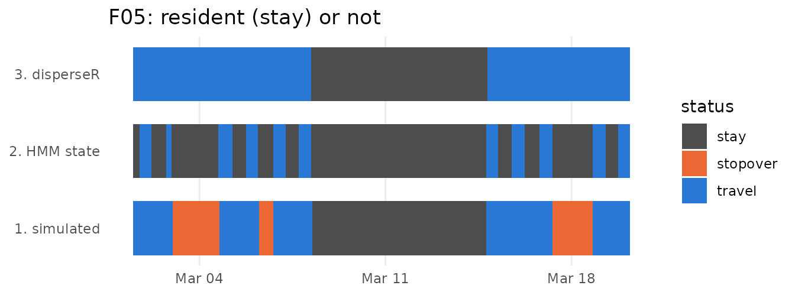

### Activity modes or movement modes: the HMM states

What the HMM states capture depends on the number of states and on the
starting values. A two-state model started near resting and moving
values separates *activity modes*: daytime rests on one side, and every
movement, including the movements inside home ranges, on the other:

``` r

hmm2 <- fitHMM.wrap(reg, ids = "id_split",
                    mean.step.1 = 300, sd.step.1 = 300,
                    mean.step.2 = 20, sd.step.2 = 20,
                    ang.con.1 = 0.5, ang.con.2 = 0.1)
```

``` r

st2 <- hmm2$data
st2$ID <- sub("_[0-9]+$", "", as.character(st2$ID))
```

``` r

hmm2$models$global_model$mle$step
#>       Transit  Encamped
#> mean 309.7578 15.138028
#> sd   280.9465  8.987033
eps2 <- get.epsilon(st2)
c(three_states = eps, two_states = eps2)
#> three_states   two_states 
#>    238.40650     40.49219
```

The step-length densities now cross at a few tens of metres, and DBSCAN
with that `epsilon` only groups the locations of each resting site. The
ARPs break into many small clusters and the classification fills with
spurious loops:

``` r

arp2 <- get.arp(st2, epsilon = eps2, delta.days = 2, pct.state1 = 0.5)
rbind(three_states = n_clusters(arp),
      two_states = n_clusters(arp2))
#>              F02 F04 F05 M01 M03
#> three_states   4   2   1   4   2
#> two_states     7  15   2  15   4
phase_sequence(class.mov(link.arp(arp2, thres = 24 * 3600)))[c("M01", "F02")]
#>                                                                                                                                                       M01 
#> "Type 0 > ARP > Type 1 > ARP > Type 1 > ARP > Type 1 > ARP > Type 2 > ARP > Type 1 > ARP > Type 1 > ARP > Type 1 > ARP > Type 3 > ARP > Type 2 or Type 1" 
#>                                                                                                                                                       F02 
#> "Type 0 > ARP > Type 2 > ARP > Type 1 > ARP > Type 1 > ARP > Type 1 > ARP > Type 1 > ARP > Type 2 > ARP > Type 1 > ARP > Type 1 > ARP > Type 2 or Type 1"
```

The three-state model, in contrast, keeps the movements inside the ARPs
in the encamped state, so the encamped locations describe the space used
during each phase. Inspecting the estimated step lengths of each state
helps to decide how many states the model needs and what they mean
(Pohle et al. 2017).

### The distance threshold epsilon

[`get.epsilon()`](https://cherraiz.github.io/disperseR/reference/get.epsilon.md)
offers three methods (`"density"`, `"mean"` and `"median"`) that can be
applied to all data, per individual or per group:

``` r

eps_tab <- sapply(c("density", "mean", "median"), function(m) {
  c(global = get.epsilon(sim_states, method = m),
    unlist(get.epsilon(sim_states, method = m, mode = "individual", ids = "ID")),
    unlist(get.epsilon(sim_states, method = m, mode = "groups", group.col = "sex")))
})
round(eps_tab)
#>        density mean median
#> global     238  167     38
#> F02        286  154     44
#> F04        238  164     36
#> F05        242  224     43
#> M01        227  161     35
#> M03        225  155     41
#> female     252  173     39
#> male       223  160     36
```

A smaller `epsilon` splits an area into more clusters, and a larger one
merges nearby areas or joins stopovers to the route:

``` r

eps_values <- c(eps / 4, eps / 2, eps, 2 * eps, 4 * eps)
eps_effect <- sapply(eps_values, function(e)
  n_clusters(get.arp(sim_states, epsilon = e, delta.days = 2, pct.state1 = 0.2)))
colnames(eps_effect) <- paste0(round(eps_values), " m")
eps_effect
#>     60 m 119 m 238 m 477 m 954 m
#> F02   17     4     4     4     4
#> F04   25     2     2     1     1
#> F05    4     1     1     2     1
#> M01   20     5     4     2     2
#> M03   13     2     2     2     2
```

### Duration, activity and minimum points

`delta.days` decides how long a cluster must last to be an ARP. It is
measured from the first to the last location of the cluster, so patches
visited repeatedly last longer than each single visit. The stay of 2.5
days of F02 is an ARP with `delta.days = 2` but not with
`delta.days = 3`. A lenient `pct.state1` accepts clusters at the border
of the areas that include transit locations. `minPts` decides which
locations are core points of a cluster: a larger value can split loosely
connected areas, such as the patches of M01:

``` r

n_arp <- function(delta = 2, pct = 0.2, minPts = 3) {
  n_clusters(get.arp(sim_states, epsilon = eps, delta.days = delta,
                     pct.state1 = pct, minPts = minPts))
}
rbind("delta.days = 0.5" = n_arp(delta = 0.5),
      "delta.days = 1"   = n_arp(delta = 1),
      "delta.days = 2"   = n_arp(delta = 2),
      "delta.days = 3"   = n_arp(delta = 3),
      "pct.state1 = 0.5" = n_arp(pct = 0.5),
      "minPts = 10"      = n_arp(minPts = 10))
#>                  F02 F04 F05 M01 M03
#> delta.days = 0.5  10   9   9  15   7
#> delta.days = 1     5   2   3   5   2
#> delta.days = 2     4   2   1   4   2
#> delta.days = 3     3   2   1   4   2
#> pct.state1 = 0.5   4   3   1   5   2
#> minPts = 10        4   2   1   5   2
```

With a short `delta.days`, stopovers become ARPs and the movements are
cut into pieces. The proportion of stopover locations classified as ARP:

``` r

mov_short <- class.mov(link.arp(get.arp(sim_states, epsilon = eps, delta.days = 0.5,
                                        pct.state1 = 0.2), thres = 24 * 3600))
rbind("delta.days = 0.5" = tapply(mov_short$data$phase[truth == "stopover"] == "ARP",
                                  mov_short$data$ID[truth == "stopover"], mean),
      "delta.days = 2"   = tapply(mov$data$phase[truth == "stopover"] == "ARP",
                                  mov$data$ID[truth == "stopover"], mean))
#>                  F02 F05 M01
#> delta.days = 0.5   1   1   1
#> delta.days = 2     0   0   0
```

### Linking threshold

`thres` decides which short trips out of an ARP are links and which are
movements. The number of Type 1 and Type 3 movements drops quickly as
`thres` grows, until it reaches the duration of the shuttles between
patches. It then stays stable while `thres` is shorter than the loops
and the movements between areas:

``` r

thres_h <- c(0, 2, 4, 6, 9, 12, 18, 24, 36, 48, 72, 96)
counts <- do.call(rbind, lapply(thres_h, function(h) {
  p <- phase.summary(suppressWarnings(class.mov(link.arp(arp, thres = h * 3600))))
  data.frame(thres = h, phase = c("Type 1", "Type 2", "Type 3"),
             n = as.vector(table(factor(p$phase, c("Type 1", "Type 2", "Type 3")))))
}))
ggplot(counts, aes(thres, n, colour = phase)) +
  geom_line(linewidth = 0.8) + geom_point(size = 2) +
  geom_vline(xintercept = 24, linetype = "dashed", colour = "grey50") +
  scale_colour_manual(values = c("Type 1" = "#eb6834", "Type 2" = "#1baf7a",
                                 "Type 3" = "#e87ba4"), name = NULL) +
  scale_x_continuous(breaks = c(0, 12, 24, 48, 72, 96)) +
  labs(x = "thres (hours)", y = "Number of movements (all individuals)")
```

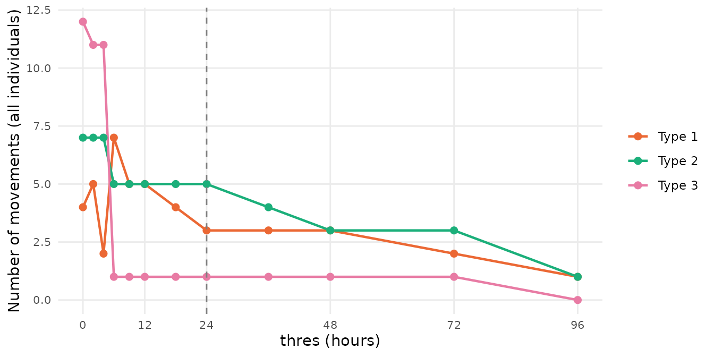

Without linking (`thres = 0`), every shuttle between the two patches of
M01 and F04 becomes a movement. With a very long `thres`, the loops, and
even the movement of M01 between its two areas, are absorbed into the
ARPs:

``` r

thres_seq <- sapply(c(0, 24, 96), function(h)
  phase_sequence(suppressWarnings(class.mov(link.arp(arp, thres = h * 3600))))[c("M01", "F04")])
colnames(thres_seq) <- paste("thres =", c(0, 24, 96), "h")
thres_seq
#>     thres = 0 h                                                                                                                                                         
#> M01 "Type 0 > ARP > Type 2 > ARP > Type 3 > ARP > Type 3 > ARP > Type 3 > ARP > Type 3 > ARP > Type 2 > ARP > Type 1 > ARP > Type 1 > ARP > Type 3 > ARP > Type 3 > ARP"
#> F04 "Type 0 > ARP > Type 2 > ARP > Type 3 > ARP > Type 3 > ARP > Type 3 > ARP > Type 1 > ARP > Type 3 > ARP > Type 3 > ARP > Type 3 > ARP"                              
#>     thres = 24 h                                               
#> M01 "Type 0 > ARP > Type 2 > ARP > Type 1 > ARP > Type 3 > ARP"
#> F04 "Type 0 > ARP > Type 1 > ARP > Type 1 > ARP"               
#>     thres = 96 h                 
#> M01 "Type 0 > ARP > Type 1 > ARP"
#> F04 "Type 0 > ARP"
```

### Establishment

With `establish = TRUE`, an ARP only counts as an established site if
the individual stays there at least `establish.days`. Shorter stays
become part of the movement. The duration is measured over the whole
stay in a linked ARP, so M01, which rarely stays three days in a row in
one of its patches, still establishes its first area:

``` r

est_seq <- sapply(c(1, 3, 9), function(d)
  phase_sequence(class.mov(linked, establish = TRUE,
                           establish.days = d))[c("F02", "M01", "F05")])
colnames(est_seq) <- paste("establish.days =", c(1, 3, 9))
est_seq
#>     establish.days = 1                                         
#> F02 "Type 0 > ARP > Type 2 > ARP > Type 2 > ARP > Type 2 > ARP"
#> M01 "Type 0 > ARP > Type 2 > ARP > Type 1 > ARP > Type 3 > ARP"
#> F05 "Type 0 > ARP > Type 2 or Type 1"                          
#>     establish.days = 3                                         
#> F02 "Type 0 > ARP > Type 2 > ARP > Type 2 > ARP"               
#> M01 "Type 0 > ARP > Type 2 > ARP > Type 1 > ARP > Type 3 > ARP"
#> F05 "Type 0 > ARP > Type 2 or Type 1"                          
#>     establish.days = 9           
#> F02 "Type 0 > ARP > Type 2"      
#> M01 "Type 0 > ARP > Type 1 > ARP"
#> F05 "Type 0"
```

With `establish.days = 3`, the 2.5-day stay of F02 becomes part of a
single Type 2 movement. With `establish.days = 9`, only the longest
settlements count: the 6-day settlement of F05 is not established, so
its whole track is an unanchored movement (Type 0).

### Minimum convex polygon for links

With `arp.links = "mcp"`, linking locations stay in the ARP only if they
fall inside the minimum convex polygon of the preceding ARP cluster.
Otherwise they become loops (Type 1). Trips between two separate patches
fall outside the polygon:

``` r

phase_sequence(class.mov(linked, arp.links = "mcp"))[c("M01", "F04")]
#>                                                                                                                                    M01 
#> "Type 0 > ARP > Type 1 > ARP > Type 1 > ARP > Type 1 > ARP > Type 2 > ARP > Type 1 > ARP > Type 1 > ARP > Type 1 > ARP > Type 3 > ARP" 
#>                                                                                                                                    F04 
#>                                              "Type 0 > ARP > Type 1 > ARP > Type 1 > ARP > Type 1 > ARP > Type 1 > ARP > Type 1 > ARP"
```

### Transferring to the raw fixes

The matching method of
[`transfer.disperseR()`](https://cherraiz.github.io/disperseR/reference/transfer.disperseR.md)
matters at the transitions between phases. `"temporal"` takes the
nearest location in time; `"forward"` and `"backward"` the nearest later
or earlier one; `"spatial"` the nearest in space, which may be far in
time; and `"movement"` and `"arp"` give priority to the movement or to
the ARP phase when a fix falls between both:

``` r

methods <- c("temporal", "spatial", "forward", "backward", "movement", "arp")
tr <- lapply(setNames(methods, methods), function(m)
  transfer.disperseR(sim_tracks, mov, id.col = "ID", time.col = "timestamp",
                     method = m, max.diff = 3600))
data.frame(
  agreement_with_temporal = round(sapply(tr, function(d)
    mean(d$phase == tr$temporal$phase, na.rm = TRUE)), 3),
  fixes_in_ARP = sapply(tr, function(d) sum(d$phase == "ARP", na.rm = TRUE)),
  no_match_within_1h = sapply(tr, function(d) sum(is.na(d$phase))))
#>          agreement_with_temporal fixes_in_ARP no_match_within_1h
#> temporal                   1.000         2378                  0
#> spatial                    1.000         2233                198
#> forward                    0.998         2377                  1
#> backward                   0.998         2380                  1
#> movement                   0.998         2371                  1
#> arp                        0.998         2386                  1
```

### Practical recommendations

- Express `delta.days`, `establish.days` and `thres` in terms of the
  biology of the species: how long a settlement must last to be
  meaningful, and how long a trip between nearby patches usually takes.
- `epsilon`, `minPts` and the HMM states depend on the sampling
  interval. With 4-hour fixes, for example, steps are longer and there
  are fewer locations per day than in this hourly example.
- Check the HMM states and the clusters on maps
  ([`draw.track()`](https://cherraiz.github.io/disperseR/reference/draw.track.md))
  before classifying the movements, and compare a few values of each
  argument, as in this part, to see how robust the classification is.

## References

Barraquand F, Benhamou S (2008) Animal movements in heterogeneous
landscapes: identifying profitable places and homogeneous movement
bouts. *Ecology* 89: 3336–3348. <https://doi.org/10.1890/08-0162.1>

Beier P (1995) Dispersal of juvenile cougars in fragmented habitat.
*Journal of Wildlife Management* 59: 228–237.
<https://doi.org/10.2307/3808935>

Berger-Tal O, Saltz D (2014) Using the movement patterns of reintroduced
animals to improve reintroduction success. *Current Zoology* 60:
515–526. <https://doi.org/10.1093/czoolo/60.4.515>

Bowler DE, Benton TG (2005) Causes and consequences of animal dispersal
strategies: relating individual behaviour to spatial dynamics.
*Biological Reviews* 80: 205–225.
<https://doi.org/10.1017/S1464793104006645>

Calabrese JM, Fleming CH, Gurarie E (2016) ctmm: an R package for
analyzing animal relocation data as a continuous-time stochastic
process. *Methods in Ecology and Evolution* 7: 1124–1132.
<https://doi.org/10.1111/2041-210X.12559>

Cisneros-Araujo P, Garrote G, Corradini A, et al. (2025) Movement phases
make a difference in habitat selection: Iberian lynx diversity of
responses to human-modified landscapes. *Journal of Animal Ecology* 94:
1983–1996. <https://doi.org/10.1111/1365-2656.70099>

Cisneros-Araujo P, Garrote G, Sarmento P, et al. (2026a) Acclimatisation
duration, not just release type, drives post-release settlement in a
large-scale carnivore reintroduction programme. *Journal of Applied
Ecology* 63: e70402. <https://doi.org/10.1111/1365-2664.70402>

Cisneros-Araujo P, Gastón A, Cubero D, et al. (2026b) A hidden Markov
framework for joint identification of animal activity modes and movement
phases. *Landscape Ecology* 41: 72.
<https://doi.org/10.1007/s10980-026-02304-3>

Clobert J, Baguette M, Benton TG, Bullock JM (eds) (2012) *Dispersal
Ecology and Evolution*. Oxford University Press, Oxford.

Edelhoff H, Signer J, Balkenhol N (2016) Path segmentation for
beginners: an overview of current methods for detecting changes in
animal movement patterns. *Movement Ecology* 4: 21.
<https://doi.org/10.1186/s40462-016-0086-5>

Elliot NB, Cushman SA, Macdonald DW, Loveridge AJ (2014) The devil is in
the dispersers: predictions of landscape connectivity change with
demography. *Journal of Applied Ecology* 51: 1169–1178.
<https://doi.org/10.1111/1365-2664.12282>

Ester M, Kriegel H-P, Sander J, Xu X (1996) A density-based algorithm
for discovering clusters in large spatial databases with noise.
*Proceedings of the Second International Conference on Knowledge
Discovery and Data Mining* (KDD-96): 226–231.

Gastón A, Blázquez-Cabrera S, Garrote G, et al. (2016) Response to
agriculture by a woodland species depends on cover type and behavioural
state: insights from resident and dispersing Iberian lynx. *Journal of
Applied Ecology* 53: 814–824. <https://doi.org/10.1111/1365-2664.12629>

Getz WM (2022) A hierarchical path-segmentation movement ecology
framework. *Ecological Processes* 11: 56.
<https://doi.org/10.1186/s13717-022-00399-5>

Gurarie E, Bracis C, Delgado M, et al. (2016) What is the animal doing?
Tools for exploring behavioural structure in animal movements. *Journal
of Animal Ecology* 85: 69–84. <https://doi.org/10.1111/1365-2656.12379>

Hahsler M, Piekenbrock M, Doran D (2019) dbscan: fast density-based
clustering with R. *Journal of Statistical Software* 91(1): 1–30.
<https://doi.org/10.18637/jss.v091.i01>

Langrock R, King R, Matthiopoulos J, et al. (2012) Flexible and
practical modeling of animal telemetry data: hidden Markov models and
extensions. *Ecology* 93: 2336–2342. <https://doi.org/10.1890/11-2241.1>

McClintock BT, Michelot T (2018) momentuHMM: R package for generalized
hidden Markov models of animal movement. *Methods in Ecology and
Evolution* 9: 1518–1530. <https://doi.org/10.1111/2041-210X.12995>

Morales JM, Haydon DT, Frair J, Holsinger KE, Fryxell JM (2004)
Extracting more out of relocation data: building movement models as
mixtures of random walks. *Ecology* 85: 2436–2445.
<https://doi.org/10.1890/03-0269>

Nathan R, Getz WM, Revilla E, et al. (2008) A movement ecology paradigm
for unifying organismal movement research. *Proceedings of the National
Academy of Sciences* 105: 19052–19059.
<https://doi.org/10.1073/pnas.0800375105>

Patin R, Etienne M-P, Lebarbier E, Chamaillé-Jammes S, Benhamou S (2020)
Identifying stationary phases in multivariate time series for
highlighting behavioural modes and home range settlements. *Journal of
Animal Ecology* 89: 44–56. <https://doi.org/10.1111/1365-2656.13105>

Pohle J, Langrock R, van Beest FM, Schmidt NM (2017) Selecting the
number of states in hidden Markov models: pragmatic solutions
illustrated using animal movement. *Journal of Agricultural, Biological
and Environmental Statistics* 22: 270–293.
<https://doi.org/10.1007/s13253-017-0283-8>

Saura S, Bodin Ö, Fortin M-J (2014) Stepping stones are crucial for
species’ long-distance dispersal and range expansion through habitat
networks. *Journal of Applied Ecology* 51: 171–182.
<https://doi.org/10.1111/1365-2664.12179>

Zimmermann F, Breitenmoser-Würsten C, Breitenmoser U (2005) Natal
dispersal of Eurasian lynx (*Lynx lynx*) in Switzerland. *Journal of
Zoology* 267: 381–395. <https://doi.org/10.1017/S0952836905007545>
